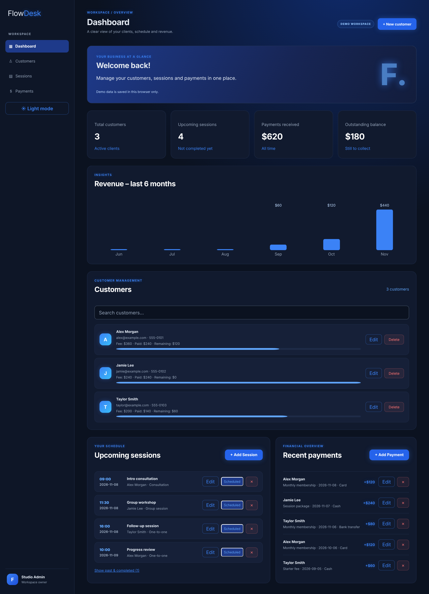
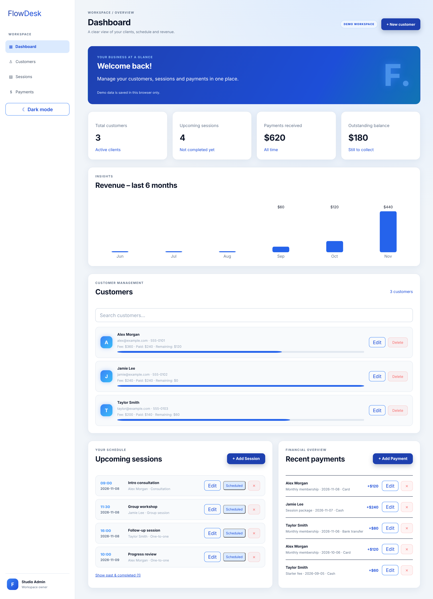
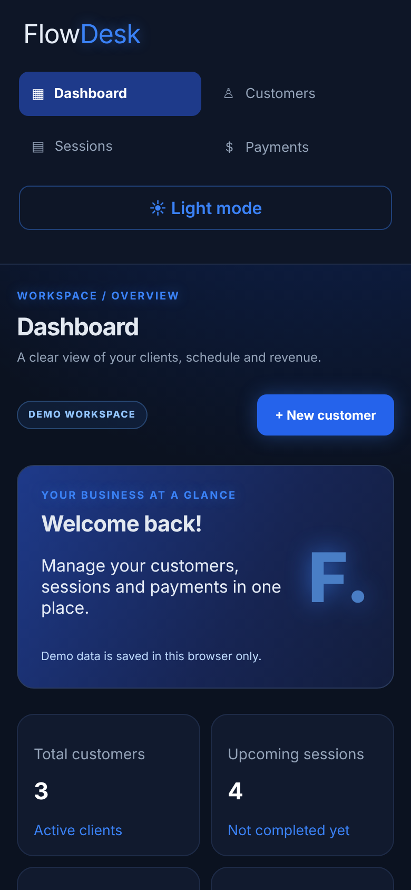

# FlowDesk

FlowDesk is a React dashboard concept for independent studios and small service businesses to manage customers, sessions, and payments.

## Demo capabilities

- Add, edit, search (name, email, phone), and remove customers
- Track customer fees, received payments, and outstanding balances (money is summed in integer cents)
- Add, edit, complete, and remove sessions; the list shows upcoming sessions, with past and completed ones behind a toggle
- Add, edit, and remove payments, with a warning when a payment exceeds the remaining balance
- Six-month revenue chart; demo data uses dates relative to today so the chart is never empty
- Dark and light themes (the saved theme is applied before first paint)
- Persist demo data in the current browser with `localStorage`. Changes sync between tabs, and unreadable data is backed up under `<key>:corrupt-backup` before defaults are restored

## Important demo limitation

This version is a **frontend portfolio demo**. It does not have a backend, database, user authentication, cloud synchronization, or server-side authorization. Data is stored only in the browser where it is entered. Do not use it for real customer or payment information. A production version needs a backend/API, a database, authentication, authorization, validation on the server, and secure deployment configuration.

## Project structure

```
src/
  App.jsx                   composes the page
  hooks/useWorkspace.js     data, derived totals and all save/delete actions
  hooks/useLocalStorage.js  sanitized, tab-synced localStorage state
  components/               Sidebar, StatCards, RevenueChart, CustomerForm/List, SessionPanel, PaymentPanel
  utils/format.js           money (cents), dates, small helpers
  utils/sanitize.js         validation for form input and stored data
  utils/demoData.js         relative-date demo data
```

## Run locally

Requirements: Node.js 20.19+ or 22.12+ (Vite 8 requirement) and npm.

```bash
npm install
npm run dev
```

## Tests and lint

```bash
npm test        # unit tests for validation and money/date helpers (Node's built-in runner, no extra dependencies)
npm run lint
```

## Production build

```bash
npm run build
npm run preview
```

For Netlify, use these build settings:

- Build command: `npm run build`
- Publish directory: `dist`

## Security headers

`vite.config.js` is the single source of truth for the production policy:

- a `<meta>` Content Security Policy is injected into `index.html` (works on any static host), and
- a Netlify `_headers` file is emitted into `dist/` with the same policy plus `frame-ancestors 'none'`, `upgrade-insecure-requests`, HSTS, `X-Content-Type-Options`, `Referrer-Policy`, `Permissions-Policy`, and long-lived caching for hashed assets.

The policy uses `style-src 'self'` and `script-src 'self'`, so the app must not use inline `<script>` tags, `<style>` tags, or `style="..."` attributes. The chart and payment progress bars therefore use SVG geometry. Neither the meta tag nor `_headers` is applied by the dev server.
# Screenshots

Here are some previews of FlowDesk:

# Dashboard


# Customers


# Payments
